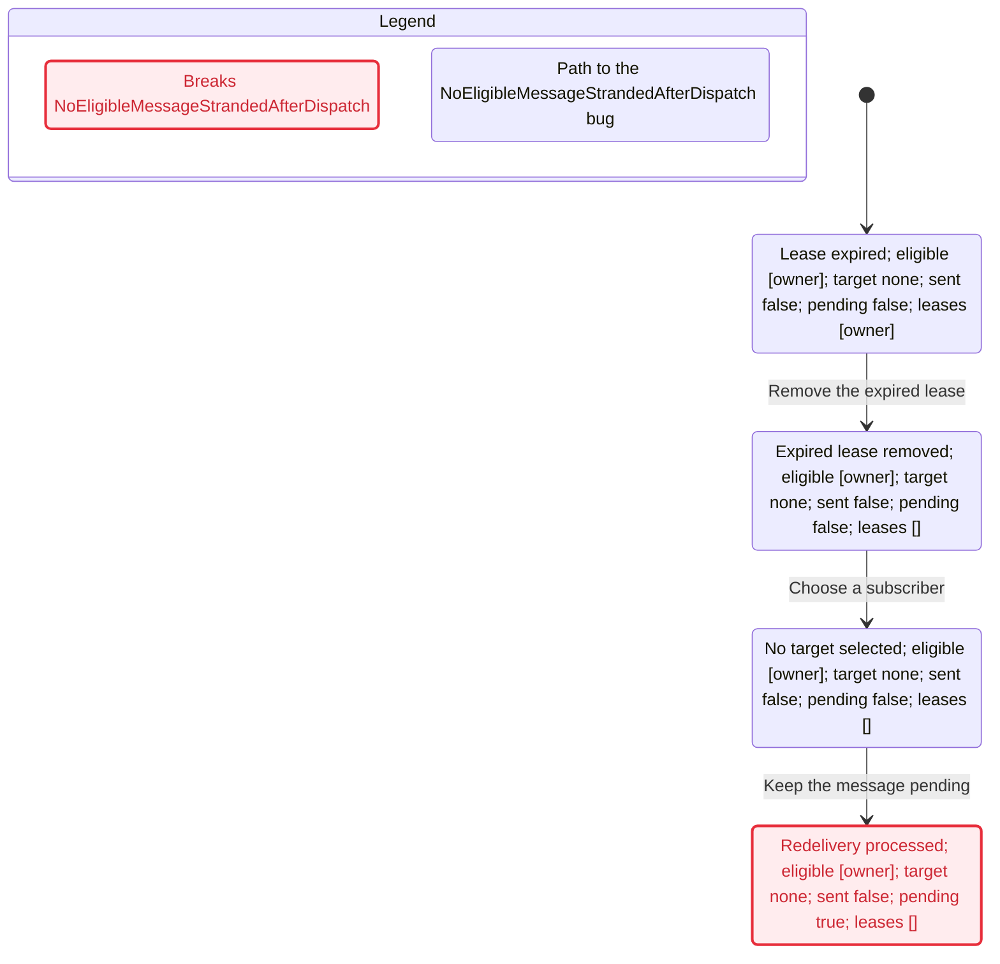

# Bounded C++ and fakeamps delivery checks

These checks describe a small part of the official AMPS C++ 5.3.5.14 client
and the fake broker. TLC exhausts the stated models; it does not execute or
prove either implementation. The separate native probe in `tools/cppfakeamps`
executes the official client against fakeamps.

## Replay and routing

For one subscribed client, the journal initially contains messages 1 and 2;
message 3 is published after historical replay has finished. The model requires
these exact callback sequences:

| Subscription | Expected IDs |
| --- | --- |
| Plain, no bookmark | 3 |
| EPOCH (`0`) | 1, 2, 3 |
| NOW (`0\|1\|`) | 3 |
| Explicit bookmark from message 1 | 2, 3 |

`AllExpectedDelivered` requires the complete sequence at the terminal state;
`NoUnexpectedDelivery` requires every earlier callback sequence to be a prefix
of that expected sequence. They are safety checks and do not establish eventual
progress if the environment stops executing steps.

The symbolic bookmark is set by `Client::subscribe` in SDK
`include/ampsplusplus.hpp`, recognized through fakeamps `parseAMPSHeader` and
`handleConnection`, and selected by `messageJournal.replayFrom` and
`parseBookmarkSeq`. For each historical or live publication,
`buildPublishDelivery` supplies `sids`. C++ `Client`'s publish callback reads
`AMPS_SubscriptionIds`, and `MessageRouter::parseRoutes` finds the callback.
The model assumes the route already exists and the received frame is parsed
correctly. It does not model the bytes of the parser or bookmark arithmetic;
the Go and native C++ regression tests provide separate concrete evidence.

The subscription succeeds, one valid matching topic is used, journal and
fanout are enabled, the journal retains both entries, the C++ subscription has
no bookmark store, and no filter, queue, SOW, reconnect, or send failure is
involved. The broker's registration, journal snapshot, frame writes, and live
fanout are **not** one atomic operation. The model deliberately puts the live
publish after historical replay: it does not check concurrent snapshot/live
interleavings, deduplication, or their ordering.

## Expired queue lease

`CppQueueLease` models one expired message and at most two eligible push
subscribers. The original owner has a known connection. The alternate may have
the same subscription ID on a different connection. Eligibility is fixed
throughout the modeled dispatch. The five configurations include no eligible
subscriber, only the owner, only the alternate, and both subscribers with
different or equal IDs.

After expiry, `requeueExpiredLeases` removes the old lease under
`queueLeasesMu`, releases the lock, and schedules `requeueMessage` separately.
The latter calls `selectQueueRedeliveryTarget`, which gathers eligible
subscriptions using `queueSubEligibleForDelivery`, chooses an alternate before
falling back to the original owner, and either sends then records a new lease
or adds a pending message. The model keeps removal, selection, sending,
recording, and enqueueing as separate steps. It assumes they are not
interleaved with another dispatch, registration, acknowledgment, or capacity
change; the selector's several locks do **not** make the overall flow atomic.

At the terminal state, `NoEligibleMessageStrandedAfterDispatch` requires a
recorded lease when a subscriber is eligible; `PreferOtherWhenEligible`
requires the different connection when it is eligible; and
`RetainedAfterDispatch` requires either pending storage or a recorded lease.
`UniqueLease` means at most one *recorded* owner for this one modeled message.
It is not a claim that concurrent deliveries or callbacks are unique. Network
failures, multiple messages, unknown original connection, real-time expiry,
and wakeups or retries after a message becomes pending are outside this model.

## Deliberate breaks and source evidence

The runner requires a specific counterexample for every listed variant and
checks the corresponding real Go test with an isolated source overlay when
practical. It runs each unmodified test first.

| Broken variant | Counterexample and real regression |
| --- | --- |
| Omit `sids` | C++ route lookup delivers none of the three messages; `TestCPPDeliveryRoutingFieldsAndEscapedHeaders`. |
| Ignore bookmark presence | An EPOCH subscription receives only the live message; `TestCPPBookmarkSubscribeReplayByBookmarkField/epoch`. |
| Treat NOW as EPOCH | A historical message reaches the NOW subscriber; `TestCPPBookmarkSubscribeReplayByBookmarkField/now`. |
| Omit owner fallback | The expired message remains pending despite an eligible sole subscriber; `TestCPPQueueRequeuesExpiredLeaseToOnlySubscriber`. |
| Exclude the other connection because its ID matches | The old owner is selected instead of the eligible alternate; `TestCPPQueueRedeliveryTargetUsesConnectionIdentity/same_ID_on_another_connection`. |
| Drop a message when no subscriber is eligible | Neither pending storage nor a lease remains; `TestRequeueMessageQueuesPendingWhenNoSubscriberAvailable`. |
| Permit two recorded owners for one message | `UniqueLease` fails in the abstract model. The actual lease map is keyed by message key; this structural hypothetical has no matching Go overlay. |

These are deliberately broken variants, not findings against the checked
sources. For the identity overlay, the Go test has an additional third
subscriber so its assertion remains deterministic despite map iteration order.

The 2026-11-02 run used TLC 1.7.4: all nine normal configurations passed,
seven broken-model configurations produced their expected counterexamples,
and six real Go mutations failed their intended assertions. Each result was
read with `statechart`. The preserved run and chart folders for this workspace
are `G:/dev/caches/tmp/amps-cpp-formal-final-v2` and
`G:/dev/caches/tmp/amps-cpp-charts-final-v2`. A scratch removal of the
bookmark guard was also rejected as source drift before the normal rerun.

## A rejected counterexample

This generated [Mermaid trace](../formal/CppQueueLease-counterexample.mmd)
shows the deliberately broken no-fallback variant. It removes the expired
lease, ignores the eligible owner, and leaves the message pending after the
dispatch attempt. The fixed source passes the invariant; restoring this
variant is also caught by its real Go regression. Paths and charts for all
sixteen model results are preserved in the workspace chart folder above.



## Reproduce and maintain

Install Java 11 or newer, Python, Go 1.26.10, and the unmodified Windows C++ SDK
5.3.5.14. Set `TLA2TOOLS` to the pinned TLC 1.7.4 jar, or let the existing
checker download and verify it. From the repository root:

```text
python tools/formalcheck/cpp_check.py --sdk-root PATH_TO_SDK
```

Omit `--sdk-root` when the SDK is in
`.tmp/parity-audit/reference/amps-c++-client-5.3.5.14-Windows`. The check
requires matching repository and SDK hashes in `formal/cpp-source-sync.json`,
including the SDK's `amps.lib`, and writes raw TLC output, configs, overlay
sources, Go logs, and a summary to the printed temporary directory. `--out`
selects a new empty directory outside the repository; `--models-only` omits
the Go mutations. Reading SDK source alongside the shipped binary does not
establish that the binary was built from that source.

Read every model result with the pstack `statechart` skill, using
`formal/cpp-statechart-view.mjs`; preserve charts and failing traces outside
the repository. Replay each failure against the named functions and tests.
The local `verify-cpp-fakeamps` skill explains when to rerun and how to review
source drift. The sync record names the confirmed source commit
`22c28b481fc150cd984a21bac8bc97f67c9d855d`, with no pending changes to the
covered repository sources. Source and SDK hashes identify the checked snapshot
even when a later commit changes only verification files.
Update these hashes only after reviewing changed source and tests against the
model, then repeat the check and statechart review.

The committed-source rerun is preserved in
`G:/dev/caches/tmp/amps-client-go-second-fixes/formal-cpp-v1.1.0-committed`.
Its sixteen model result records, including hashes and constants, match the
interpreted statecharts above; all six real Go mutations were killed again.
